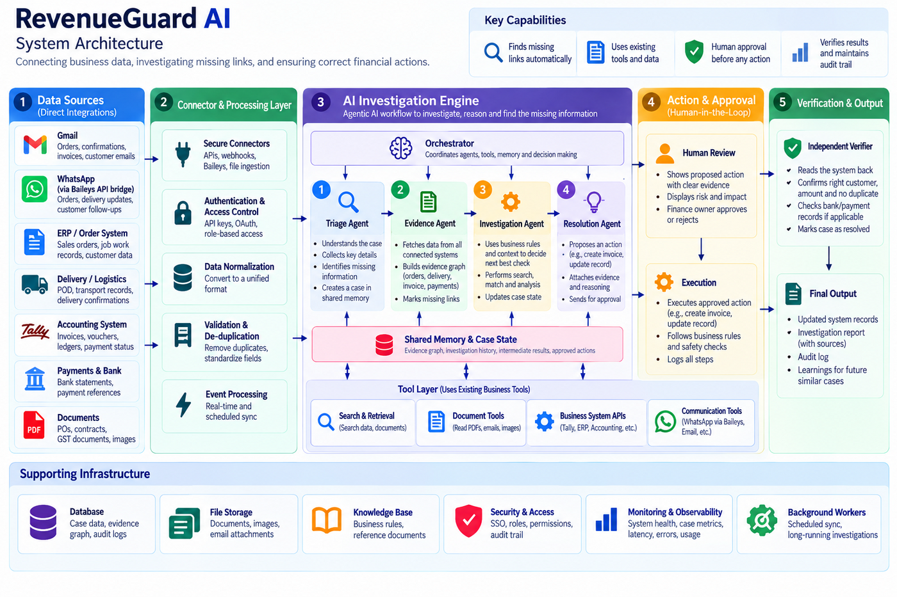

# RevenueGuard AI: order-to-cash exception investigator

RevenueGuard AI looks for money that is leaking between **order → delivery → invoice → payment**. It reads Gmail, WhatsApp (text, challan photos, Hinglish voice notes), Google Sheets, Google Drive, Zoho Books and a bank CSV. It opens a **case** when something does not add up, for example "goods delivered but never invoiced". Four scoped AI agents collect and cross-check the evidence. Plain code (not the LLM) does the maths, checks the policy, takes human approval, writes to Zoho **exactly once**, and then reads Zoho back to confirm the write. Every step is checkpointed and audited. The whole thing runs in **demo mode with zero API keys**. You only add Google, Zoho, NVIDIA, Groq and WhatsApp when you want to go live.

> Demo story: customer PO-184 for 100 × Model X @ ₹1,000. The challan photo and voice note say 60 were delivered, then ops sends "Correction: 70 delivered". There is no invoice in Zoho. RevenueGuard proposes a ₹70,000 invoice, a finance user approves it, the invoice is written once, and the verifier passes. Full presenter script: [`docs/DEMO_SCRIPT.md`](docs/DEMO_SCRIPT.md).

---

## 1. Architecture



```
                         Browser  http://localhost:3000
                                   │  REST + WebSocket (/ws?token=)
                                   ▼
 ┌──────────────┐   HTTP    ┌───────────────────────────────┐   HTTP (HMAC)   ┌───────────────────┐
 │ web  :3000   │──────────▶│ api  :8000  (FastAPI)          │◀───────────────▶│ harness  :3100    │
 │ Next.js 14   │           │  • case state machine (code)   │  /agents/run    │ DeepSeek Harness  │
 └──────────────┘           │  • validator / policy / gates  │  /tools/<name>  │ 4 scoped agents   │
                            │  • action gateway + verifier   │  /internal/     │ LLM router:       │
                            │  • connectors, multimodal      │  agent-events   │ NIM → Groq →Ollama│
                            └──┬──────┬──────┬──────┬───────┘                 └───────────────────┘
                               │      │      │      │
              ┌────────────────┘      │      │      └──────────────────┐
              ▼                       ▼      ▼                         ▼
     ┌─────────────────┐   ┌──────────────┐ ┌──────────────┐  ┌──────────────────┐
     │ worker (ARQ)    │   │ laya  :8100  │ │ wa-bridge    │  │ external (live): │
     │ resumes cases   │   │ triage +     │ │ :3001        │  │ Gmail, Sheets,   │
     │ from checkpoint │   │ injection    │ │ Baileys      │  │ Drive, Zoho Books│
     └─────────────────┘   │ scoring      │ │ (WhatsApp)   │  │ India, NIM, Groq │
                           └──────────────┘ └──────────────┘  └──────────────────┘
     ┌──────────────────────┐ ┌──────────────┐ ┌───────────────────────┐
     │ postgres :5432       │ │ redis :6379  │ │ minio :9000 (objects) │
     │ (pgvector)           │ │ (ARQ queue)  │ │ PDFs, photos, audio   │
     └──────────────────────┘ └──────────────┘ └───────────────────────┘
```

| Service | Port | Tech | Job |
|---|---|---|---|
| `web` | 3000 | Next.js 14, TS, Tailwind | Dashboard: cases, case file, approvals, triage, escalations, connectors, audit, metrics, Demo Control Room |
| `api` | 8000 | Python 3.12, FastAPI, SQLAlchemy 2, Alembic | Orchestrator, intake, validator, approvals, action gateway, verifier, connectors, WebSocket |
| `worker` | – | ARQ (same image as api) | Runs case advancement jobs; resumes every open case from its last checkpoint on start-up |
| `harness` | 3100 | Node 22, TS, DeepSeek Harness (`dsh`) | Runs the four agents with tool allow-lists, budgets, output schemas, LLM fallback |
| `laya` | 8100 | Python, `laya` Router | Fast triage answers (severity, exception type, genuine?, needs review?, injection?) with a keyword fallback |
| `wa-bridge` | 3001 | Node 22, TS, Baileys | WhatsApp link via QR, message/media store, idempotent send |
| `postgres` / `redis` / `minio` | 5432 / 6379 / 9000 | – | State, queue, media objects |

Service-to-service calls are signed: `X-RG-Signature: sha256=<hmac>` + `X-RG-Timestamp` (rejected if the clock skew is more than 300 s) using `INTERNAL_HMAC_SECRET`. The full contract is in [`docs/CONTRACT.md`](docs/CONTRACT.md) and the design reasoning is in `docs/design-doc.txt`.

---

## 2. How orchestration works

### 2.1 Code owns the state machine

The LLM never decides what state a case is in. `services/api/app/orchestrator/engine.py` does.

```
INTAKE → TRIAGED → WATCHING → EVIDENCE_READY → VALIDATED ⇄ INVESTIGATING → PROPOSED
       → AWAITING_APPROVAL → EXECUTING → VERIFYING → CLOSED

side states:  PAUSED     connector down / evidence incomplete (auto-resumes)
              ESCALATED  conflict, budget hit, invalid agent output after 2 retries
              BLOCKED    policy violation
```

* Every transition writes a `case_checkpoints` row (state, payload, `evidence_version`), an `audit_log` row (hash-chained), and a WebSocket event.
* The case is **durable**. If the worker dies mid-run, it picks up from the latest checkpoint on restart (`resume_all`). You can also nudge it with `POST /cases/{id}/resume`.
* `VALIDATED ⇄ INVESTIGATING`: when the validator finds a gap or conflict, the case goes to investigation. New evidence comes back for re-validation. It loops until the gap is closed or a stop rule fires.
* Case-level budget: max 12 agent runs and ₹25 LLM cost per case (`CASE_BUDGET_MAX_AGENT_RUNS`, `CASE_BUDGET_MAX_COST_INR`). If the budget is crossed, the case goes to ESCALATED.

### 2.2 Four scoped agents (DeepSeek Harness)

The API calls `POST harness:3100/agents/run` with a case snapshot and a budget (default 8 steps, 40k tokens, 120 s, ₹5). The harness streams events back and validates the final JSON with zod. It retries at most 2 times, otherwise the run fails with `invalid_output` and the case is escalated.

| Agent | What it does | Tool allow-list (read-only) |
|---|---|---|
| **Triage** | Classifies the exception and severity using **Laya**, extracts PO / customer / amount / qty, attaches the item to a case or opens a new one. Low confidence (< 0.7) goes to the human triage queue. | `laya_decide`, `extract_fields`, `case_attach_or_open` |
| **Evidence** | Sweeps every source for the four links: order, delivery, invoice, payment. | `gmail_search`, `whatsapp_search`, `sheets_read_delivery`, `drive_read_doc`, `zoho_get_salesorders`, `zoho_get_invoices`, `zoho_get_payments`, `bank_get_payments`, `evidence_add` |
| **Investigation** (adaptive) | Picks the **next check from the current evidence gap** (alternate IDs, credit notes, bank, billing rules) instead of a fixed list. Stop rules: `gap_closed`, `no_new_evidence`, `conflict` (→ escalate), `budget`. | all evidence read tools + `search_alt_ids`, `search_credit_notes`, `compute_billable`, `get_billing_rules`, `evidence_add` |
| **Resolution** | Drafts the action (invoice / reminder / none). **Every claim must cite evidence node IDs.** It also lists uncertainty and risk. | `draft_action`, `risk_score`, `compute_billable` |

The allow-list is enforced twice: once in the harness `tool-policy` plugin, and once again in the API using the `X-RG-Agent` header. **No agent has a write tool.** Writes go only through the Action Gateway after human approval. If the harness is not reachable in DEMO_MODE, the API uses a clearly labelled built-in Python runner (`AGENT_RUNNER=auto|harness|builtin`).

### 2.3 Code gates (deterministic, no LLM)

| Gate | Where | What it guarantees |
|---|---|---|
| **Decimal validator** | `app/validator.py` | `normalize_ref("PO-184") → "PO184"`, `compute_billable(order_qty, delivered_qty, rate, rule)`, duplicate detection. Uses Python `Decimal`. **Validator facts override agent numbers.** |
| **Policy + citation check** | `check_proposal` | The proposal amount must equal the billable amount. Every claim must cite at least one existing evidence node. Otherwise the proposal is rejected or the case is BLOCKED. |
| **Human approval with roles** | `app/approvals.py` | Only `finance_approver` can approve (`operator` is blocked). Amounts **above ₹1,00,000 need 2 distinct approvers** (`APPROVAL_TWO_PERSON_THRESHOLD_INR`). |
| **Payload hash + evidence version binding** | approval record | The approval is bound to the exact `payload_hash` and `evidence_version` it was shown with. |
| **Auto-expiry** | `case_service.expire_approvals_on_evidence_change` | New evidence (for example "Correction: 70 delivered") or a human edit **expires the old approval**. The case then re-validates and a fresh approval is created. |
| **Action gateway** | `app/gateway.py` | In order: kill switch → approval state, roles and distinct approvers → evidence version → payload hash → **idempotency key** (unique) → **target pre-check** (does the invoice already exist?) → circuit-broken write → read-after-timeout instead of a blind retry. |
| **Independent verifier** | `gateway.verify` | Reads the invoice **back from Zoho** and compares the required fields. If it fails, the case escalates. If Zoho is down, the case goes to PAUSED. |

### 2.4 HITL and guardrail map

| Risk | Guardrail | Human in the loop? | What you see |
|---|---|---|---|
| Unclear or low-confidence item | Laya confidence < 0.7 → triage queue | Yes, an operator labels it | Triage screen |
| Prompt injection in an email or message | Laya injection score + patterns → content quarantined, zero permissions | No (automatic) | `guardrail: injection` |
| Agent makes up numbers | Decimal validator overrides; amount must equal billable | No | Validator card |
| Claim without proof | Citation check | No | Proposal rejected |
| Wrong person approves | Role check | Yes | `guardrail: role_block` (HTTP 403) |
| Big amount | 2 distinct finance approvers above ₹1,00,000 | Yes, two people | `partially_approved` |
| Evidence changes after approval | Evidence version + payload hash binding → approval expires | Yes, re-approve | `guardrail: approval_expired` |
| Double click / event replay | Idempotency key + target pre-check | No | `guardrail: duplicate_block` |
| Connector down | Circuit breaker → PAUSED → auto-resume | No | `guardrail: paused` |
| LLM provider down | NIM → Groq → Ollama fallback | No | `llm.provider` event |
| Garbage model output | zod schema, 2 retries → ESCALATED | Yes, escalation queue | Escalations screen |
| Something goes badly wrong | **Kill switch** blocks all gateway writes | Yes, admin | Kill switch button |
| Write did not really happen | Independent Zoho read-back | No | Verifier pass / fail |

### 2.5 Multimodal routing (`app/media.py`, `POST /internal/ingest-media`)

| Input | Primary | Fallback |
|---|---|---|
| PDF / scanned document | NIM **Nemotron Parse** (`NIM_PARSE_MODEL`) for text and tables, then the vision model for fields | `pypdf` text layer, then **Tesseract** OCR |
| Photo (challan, receipt) | NIM vision model (`NIM_VISION_MODEL`) | Tesseract OCR |
| Audio (WhatsApp `.ogg` voice note) | **Sarvam AI** speech-to-text (`SARVAM_STT_MODEL=saaras:v3`, `SARVAM_STT_MODE=codemix`) | NIM omni model (`NIM_OMNI_MODEL`), then Groq Whisper (`GROQ_STT_MODEL`, guarded); in DEMO_MODE only, a fixture transcript sidecar |

The original file is stored in MinIO, and the extracted text becomes an evidence node.

#### Voice notes (`app/llm/stt_sarvam.py`, `LLMRouter.transcribe`)

Order: **Sarvam → NIM omni → Groq Whisper → fixture sidecar (DEMO_MODE only)**. A provider that fails (HTTP 429/500, timeout, no key) is skipped and the next one is tried. Each successful read emits the `llm.provider` event (`provider: "sarvam" | "nim" | "groq"`, `task: "transcribe"`).

- **Sarvam** (`POST https://api.sarvam.ai/speech-to-text`, header `api-subscription-key`). It is built for Indian languages and Hinglish. We send `model=SARVAM_STT_MODEL`, `mode=SARVAM_STT_MODE` (saaras:v3 only) and `language_code=unknown` so Sarvam detects the language itself. With `saaras:v4`, the case's key terms (PO numbers, customer and item names) are sent as `keyterms`.
- **Long voice notes**: the REST API takes less than 30 s per call, so audio longer than 29 s is cut into ≤ 29 s chunks with `ffmpeg` (16 kHz mono WAV) and the transcripts are joined in order. `ffmpeg`/`ffprobe` must be on the PATH (they are in the API image).
- **Groq Whisper guard**: Whisper runs with `temperature=0` and a prompt carrying the key terms. Its output is **rejected** if it contains a known hallucination ("Thank you for watching", "Subtitles by", …), is mostly a repeated phrase, or has more than ~4 words per second of audio (duration from `ffprobe`). A rejected read is treated as **unread**: the voice note is stored and the case says it could not hear it. We never invent text.
- `LLMRouter.transcribe(...)` still returns `(text, provider)`; `transcribe_ex(...)` returns `{text, provider, model, language_code, language_probability}` (also kept on `get_llm().last_stt_meta`).
- **Health**: `GET /health` now has an `ai` block listing NIM, Groq, Ollama and **Sarvam** (configured or not, model, mode, last error).
- Chaos flag `sarvam_down` skips Sarvam to show the fallback.

### 2.6 LLM routing

All providers are OpenAI-compatible, and every model name comes from env:

1. **NVIDIA NIM**: `NIM_MODEL=auto` picks the first free NVIDIA model that answers, and skips one that NVIDIA removes (404) or that stalls (needs `NVIDIA_API_KEY`)
2. **Groq**: `GROQ_MODEL=openai/gpt-oss-120b` (needs `GROQ_API_KEY`)
3. **Ollama** (local): `OLLAMA_MODEL=qwen3:8b` (set `OLLAMA_ENABLED=true` for the API **and** `OLLAMA_DISABLED=false` for the harness)

A circuit breaker (3 failures, 30 s cool-down) moves to the next provider. You can change the order in the harness with `LLM_PROVIDER_ORDER=nim,groq,ollama`. With `MOCK_LLM=true`, the harness uses a deterministic mock model.

---

### 2.7 Business API (UX v2, `docs/CONTRACT_V2.md`)

Plain-language business layer used by the new screens. Everything is derived from the existing cases, evidence,
validator facts, approvals, actions and the accounting (Zoho) / bank data; nothing here writes money or messages.
Headlines come from fixed templates in `services/api/app/plain_language.py` (English, Hindi, Telugu), never from an LLM.

| Endpoint | Who | What |
|---|---|---|
| `GET /dashboard/summary?period=month\|30d\|quarter` | any | money strip, Money Flow, top "to bill" / "to chase" / approvals |
| `GET /bill?status=&customer=&q=&lang=` | any | deliveries not billed (`not_billed`, `partial`, `needs_check`, `scheduled`; `status=not_billable` lists marked ones) |
| `POST /bill/{case_ref}/not-billable` | operator+ | sample / replacement / returned / billed elsewhere; leaves the list, audited |
| `GET /collect?bucket=all\|0-7\|8-30\|31-60\|60+` | any | overdue invoices with reminder stage/status and snooze |
| `POST /collect/{invoice}/snooze`, `POST /collect/{invoice}/draft-reminder` | operator+ | snooze N days; draft a 7/15/30-day reminder with a `upi://pay` link. The draft is a normal customer-message **approval**; it is sent only by the Action Gateway after approval |
| `GET /cases/{ref}/summary?lang=` | any | headline, recommendation, journey, documents, facts with proofs, callouts, GST invoice preview, approval card |
| `POST /cases/{ref}/facts/{fact_id}/correct` | operator+ | "This is wrong": new evidence version, open approvals expire, validator re-runs (`delivered_qty`, `order_qty`, `rate`, `customer`) |
| `GET /approvals` (each item has `card`), `POST /approvals/bulk-approve` | approver | bulk approve calls the same single-approve logic per id (roles, 2 approvers above ₹1,00,000, hash, expiry) |
| `GET /customers`, `GET /customers/{id}` | any | outstanding, overdue, days to pay vs terms, risk with its rule, orders, follow-ups |
| `GET /unlinked`, `POST /unlinked/{id}/link`, `POST /unlinked/{id}/ignore`, `GET /aliases` | link/ignore: operator+ | messages we could not match; linking teaches aliases ("184" = PO-184, "Exmpl Cust" = Example Customer Pvt Ltd) used by intake matching |
| `GET /reports/summary?from=&to=`, `GET /reports/export?format=csv` | any | recovered by month, unbilled ageing, collections; CA export with GST columns |
| `GET/PUT /settings`, `GET /settings/team`, `GET/PUT /settings/notifications`, `PUT /me/phone` | PUT settings: admin; others: self | GSTIN, UPI VPA, digest time, reminder ladder, GST rate, e-invoice threshold, language; approver phones for WhatsApp approvals |
| `GET /connectors` (+ `health`, `last_sync`, `error_plain`), `GET/PUT /connectors/whatsapp/chats` | PUT: admin | WhatsApp chat picker; PUT is forwarded to wa-bridge `PUT /allowlist` |
| `POST /connectors/sheets/propose-mapping`, `POST /connectors/sheets/config {mapping}` | admin | smart column mapping (synonyms, then value patterns, LLM last); used by `read_delivery` |
| `POST /setup/backfill {days}`, `GET /setup/backfill` | POST: admin | 90-day backfill (ARQ job `run_backfill`) with progress per source and the first case to look at |
| `POST /ask {question, lang}` | any | read-only deterministic router (receivables over X, unbilled, why wasn't PO-N billed, invoice, customer); refuses write requests |
| `POST /internal/wa-approval-reply` | wa-bridge (HMAC) | approver replied 1/2/3; checks a short-lived token tied to approval id + payload hash + phone and that the phone belongs to a finance approver, then calls the same approve/reject |
| `POST /demo/showcase`, `POST /demo/seed-business` | DEMO_MODE | full demo data: PO-184 at the ₹70,000 (+GST = ₹82,600) approval after the 60→70 correction, injection quarantined, PO-185 ₹2,00,000 waiting for two approvers, plus 6 more customers, invoices, reminders and unlinked messages |

GST: invoice proposals carry a `gst` block (CGST+SGST in the same state, IGST otherwise, default 18%, round-off) that is
part of the hashed, approved payload, so an approval can never be used for different tax lines. The mock Zoho invoice
total includes GST (₹70,000 + ₹12,600 = ₹82,600). For live Zoho set `connectors.zoho.config.tax_ids` (e.g.
`{"18": "<zoho tax_id>"}`); without it the invoice is written without tax and the verifier checks the taxable amount.

Notifications: when an approval is created and approver phones are linked, a numbered WhatsApp prompt goes out through
wa-bridge `POST /send-internal` (best-effort, never blocks); after the verifier passes the approvers get "Done. Invoice ...
checked". The opt-in daily digest runs as an ARQ cron (`digest_tick`, every minute, sends once a day at the tenant time,
default 09:00 IST) and is audited (`digest.sent`). Team receipts ("Got it ✓ Added to PO-184", "Which PO is this for?")
can be turned off with `receipts_enabled`.

New tables (migration `0002_ux_v2_business`): `tenant_settings`, `aliases`, `unlinked_items`, `not_billable_marks`,
`snoozes`, `reminders`, `user_phones`, `notification_prefs`, `sheet_mappings`, `backfill_jobs`.

## 3. Repo layout

```
revenueguard/
  docker-compose.yml          # postgres(pgvector), redis, minio, api, worker, laya, wa-bridge, harness, web
  docker-compose.gpu.yml      # GPU override (NVIDIA)
  .env.example                # copy to .env
  docs/                       # CONTRACT.md, design-doc.txt, architecture.png, DEMO_SCRIPT.md
  services/api/               # FastAPI app, orchestrator, validator, gateway, connectors, demo scenes, tests
    app/orchestrator/         #   engine.py (state machine), agents.py, builtin_agents.py
    app/connectors/           #   google.py, zoho.py, whatsapp.py, bank.py, mock.py
    app/demo/                 #   scenes.py (0–14), seed.py, fixtures/
    alembic/                  #   DB migrations
  services/harness/           # DeepSeek Harness runtime + RevenueGuard plugins (see its README)
  services/laya/              # Laya decision service
  services/wa-bridge/         # Baileys WhatsApp bridge (see its README)
  apps/web/                   # Next.js dashboard (see its README)
  eval/                       # synthetic labelled cases, runner, results/latest.md
```

---

## 4. Quick start (demo mode, zero keys)

Prerequisites: Docker Desktop (or Docker Engine + Compose v2), about 8 GB RAM free for Docker, and ports 3000, 8000, 3001, 3100, 8100, 5432, 6379 and 9000 free.

```bash
cd revenueguard
cp .env.example .env          # DEMO_MODE=true by default, no keys needed
docker compose up --build     # first build takes a few minutes
```

Then open **http://localhost:3000**.

**Demo users** (seeded by `services/api/app/demo/seed.py`; the login page has one-click buttons). The password for all of them is **`demo1234`**.

| Email | Role | Can do |
|---|---|---|
| `admin@demo.in` | admin | Connectors, kill switch, demo control room |
| `ops@demo.in` | operator | Runs cases, labels triage, **cannot approve** |
| `finance@demo.in` | finance_approver | Approves writes |
| `finance2@demo.in` | finance_approver | Second approver for amounts above ₹1,00,000 |
| `viewer@demo.in` | viewer | Read-only |

To run the story, log in as `admin@demo.in`, go to **Demo control room**, click **Reset**, then click **Play scene N** (top right of the *Story* panel) for each scene. See [`docs/DEMO_SCRIPT.md`](docs/DEMO_SCRIPT.md).

Useful URLs: API docs at http://localhost:8000/docs, health at http://localhost:8000/health, harness health at http://localhost:3100/health, MinIO console as mapped in `docker-compose.yml`.

**Without Docker, UI only:** `cd apps/web && NEXT_PUBLIC_MOCK=true npm run dev`. This runs a fully client-side mock backend of the same story.

### With a GPU (NVIDIA)

```bash
docker compose -f docker-compose.yml -f docker-compose.gpu.yml up --build
```

The GPU override is meant for the Laya service (and a local model, if you run one). It needs the NVIDIA Container Toolkit (Linux) or WSL2 GPU support (Windows). See section 8.

---

## 5. Going live (real connectors)

Do these one at a time and test each one from the **Connectors** screen. Variable names are in `.env.example` and `services/api/app/config.py`.

### 5.1 Google (Gmail, Sheets, Drive)

1. Go to https://console.cloud.google.com and create a project, for example `revenueguard-dev`.
2. **APIs & Services → Library**: enable **Gmail API**, **Google Sheets API** and **Google Drive API**.
3. **OAuth consent screen**: user type *External*, publishing status **Testing**. Add **yourself as a test user** (only test users can sign in while the app is in Testing).
4. **Credentials → Create credentials → OAuth client ID → Web application**.
   * Authorised redirect URI: **`http://localhost:8000/connectors/google/callback`**. It must match `GOOGLE_REDIRECT_URI` exactly.
5. Put the values in `.env`: `GOOGLE_CLIENT_ID`, `GOOGLE_CLIENT_SECRET`, `GOOGLE_REDIRECT_URI`.
6. Scopes the code requests (`services/api/app/connectors/google.py`):
   * `https://www.googleapis.com/auth/gmail.readonly`
   * `https://www.googleapis.com/auth/gmail.send`: used **only** by the Action Gateway after approval
   * `https://www.googleapis.com/auth/spreadsheets.readonly`
   * `https://www.googleapis.com/auth/drive.readonly`

   Gmail scopes are "restricted". That is fine in Testing mode with test users, but publishing the app needs Google verification.
7. Connectors screen → **Connect Google** (`GET /connectors/google/start`). One grant covers Gmail, Sheets and Drive.
8. Set your delivery sheet: `POST /connectors/sheets/config {"spreadsheet_id": "...", "range": "Sheet1!A1:H500"}`. Columns are expected to be like `po_ref, customer, item, qty_ordered, qty_delivered, qty_pending, updated_at`.
9. Gmail is polled every `GMAIL_POLL_SECONDS` (default 60) with `GMAIL_QUERY=newer_than:14d`. Force a sync with `POST /connectors/gmail/sync`.

### 5.2 Zoho Books (India data centre)

1. Create a Zoho Books **trial / sandbox organisation** on the India DC (zoho.in). **Do not use your real books for testing.**
2. Open **https://api-console.zoho.in** → *Add Client* → **Server-based Applications**.
   * Homepage URL: `http://localhost:3000`
   * Authorised redirect URI: **`http://localhost:8000/connectors/zoho/callback`** (= `ZOHO_REDIRECT_URI`)
3. In `.env`: `ZOHO_CLIENT_ID`, `ZOHO_CLIENT_SECRET`, `ZOHO_REDIRECT_URI`, `ZOHO_DC=in` (uses `accounts.zoho.in` and `www.zohoapis.in/books/v3`).
4. **Organisation ID**: Zoho Books → Settings → *Organisation Profile* (or the `organization_id` shown in the URL). Put it in `ZOHO_ORG_ID`.
5. Scopes requested (`services/api/app/connectors/zoho.py`):
   `ZohoBooks.contacts.READ, ZohoBooks.salesorders.READ, ZohoBooks.invoices.READ, ZohoBooks.invoices.CREATE, ZohoBooks.creditnotes.READ, ZohoBooks.customerpayments.READ, ZohoBooks.settings.READ`.
   `invoices.CREATE` is used only by the Action Gateway after approval.
6. Connectors screen → **Connect Zoho** (`GET /connectors/zoho/start`). The callback also accepts Zoho's `accounts-server` parameter.
7. For the demo story on real Zoho, create the contact *Example Customer Pvt Ltd*, item *Model X* @ ₹1,000, and a sales order with reference `PO-184`.

### 5.3 LLM keys

* **NVIDIA NIM**: sign in at https://build.nvidia.com, open any model page → *Get API Key*. Set `NVIDIA_API_KEY`. Check that the model IDs in `.env` (`NIM_MODEL`, `NIM_VISION_MODEL`, `NIM_PARSE_MODEL`, `NIM_OMNI_MODEL`) are listed on build.nvidia.com for your account, and change them if not.
* **Groq**: https://console.groq.com → API Keys. Set `GROQ_API_KEY` (`GROQ_MODEL`, `GROQ_STT_MODEL`).
* **Sarvam AI** (voice notes, first choice): https://dashboard.sarvam.ai → API keys. Set `SARVAM_API_KEY` (`SARVAM_STT_MODEL=saaras:v3`, `SARVAM_STT_MODE=codemix`; use `saaras:v4` to send case key terms).
* **Ollama** (optional, local): install from https://ollama.com, then:
  ```bash
  ollama pull qwen3:8b          # = OLLAMA_MODEL
  ```
  Set `OLLAMA_ENABLED=true` (API). Containers reach it at `OLLAMA_BASE_URL=http://host.docker.internal:11434/v1`. On Linux you may need `extra_hosts: host-gateway` in compose, or the host IP.

### 5.4 WhatsApp (Baileys)

1. Set `WA_MOCK=false` for the `wa-bridge` service.
2. Connectors screen → **WhatsApp** → a QR code appears (`GET /connectors/whatsapp/qr`). On the phone, open WhatsApp → *Linked devices* → *Link a device* and scan it.
3. Auth is kept in the `/data/auth` volume, so you do not need to re-scan after a restart.
4. ⚠️ **Use a spare number, not your personal one.** Baileys is an **unofficial** WhatsApp Web client. WhatsApp can ban numbers that automate. The bridge rate-limits sends (`WA_SEND_RATE_PER_MIN=20`), but there is no guarantee. For production, move to the official WhatsApp Business Cloud API.

### 5.5 Switching off demo / mock flags

| Flag | Where | Live value |
|---|---|---|
| `DEMO_MODE` | api, worker | `false` (real connectors; `/demo/*` and `mock-connect` return 403) |
| `AGENT_RUNNER` | api | `harness` (no silent built-in fallback) |
| `MOCK_LLM` | harness | `false` |
| `HARNESS_ENGINE` | harness | `dsh` (default) |
| `WA_MOCK` | wa-bridge | `false` |
| `NEXT_PUBLIC_MOCK` | web | `false` |
| `OLLAMA_ENABLED` | api | `true` only if you run Ollama |
| `OLLAMA_DISABLED` | harness | `false` only if you run Ollama |

Also change these before anyone else can reach the app: `JWT_SECRET`, `INTERNAL_HMAC_SECRET` (the same value in api, harness and wa-bridge), `FERNET_KEY` (generate with `python -c "from cryptography.fernet import Fernet; print(Fernet.generate_key().decode())"`; it encrypts OAuth tokens), and the MinIO and Postgres passwords. Then `docker compose up -d --build`.

---

## 6. Running tests

```bash
# API (Python 3.12)
cd services/api && pip install -r requirements.txt && pytest
#   validator, gateway idempotency, approval expiry, state-machine resume, tool allow-list, full demo story
#   + UX v2: plain-language templates (en/hi/te), GST preview, every business endpoint group, WhatsApp approvals, digest
#   SQLite by default; TEST_DATABASE_URL=postgresql+asyncpg://rg:rg@localhost:5432/<db> runs the same suite on Postgres

# Harness and WhatsApp bridge (Node 22)
cd services/harness  && npm ci && npm test
cd services/wa-bridge && npm ci && npm test

# Web (type-check + production build)
cd apps/web && npm ci && npm run build
```

---

## 7. Running the eval

```bash
# from the repo root
python -m eval.run                      # default: --split test, all three approaches
python -m eval.run --split all --approaches adaptive --limit 10
```

Results go to `eval/results/latest.md` and `latest.json`, and are shown on the Metrics screen (`GET /eval/latest`). Latest run: 48 synthetic test cases, 12 scenario types.

| | rules_only | fixed_sequence | adaptive |
|---|---|---|---|
| outcome accuracy | 41.7% | 100% | 100% |
| unsafe writes | 20 | 0 | 0 |
| duplicate writes | 4 | 0 | 0 |
| useful next-check rate | n/a | 0% | 88.9% |
| tool calls / case (median) | 3 | 21 | 16.5 |

**Please read this honestly.** The cases are synthetic, and they were written by the same team, alongside the built-in deterministic agents and mock LLM providers. So 100% means "the guardrails and orchestration behave as designed on scenarios we expected". It does **not** mean "the system is 100% accurate on real business data". The useful numbers are the *relative* ones: unsafe and duplicate writes drop from 20 / 4 to 0 when the code gates are on, and adaptive investigation uses fewer tool calls than a fixed sequence. A run with live NIM/Groq models through the harness will differ and should be reported separately. Human investigation time is not measured.

---

## 8. Windows notes

* Use **WSL2 + Docker Desktop** (Settings → General → *Use the WSL 2 based engine*). Clone the repo **inside the WSL filesystem** (`~/revenueguard`, not `/mnt/c/...`). Builds are much faster and file watching works.
* Line endings: run `git config --global core.autocrlf input` before cloning, so shell scripts do not break.
* **GPU**: install the latest NVIDIA Windows driver (it includes WSL GPU support). Check with `nvidia-smi` inside WSL. Docker Desktop with the WSL2 backend then supports `--gpus`. On native Linux, install the **NVIDIA Container Toolkit**.
* **16 GB RAM laptop tips**:
  * Limit WSL memory in `%UserProfile%\.wslconfig`:
    ```ini
    [wsl2]
    memory=10GB
    processors=6
    ```
  * Run **Laya on CPU** (`LAYA_DEVICE=cpu`, `LAYA_WARM_MODELS=english`) or set `LAYA_DISABLE=1` to use the keyword heuristic.
  * **Skip Ollama** (`OLLAMA_ENABLED=false`). An 8B model needs about 6 GB on its own, so use NIM/Groq or the mock LLM instead.
  * Do not use the GPU override if you do not have a discrete NVIDIA GPU.
* Windows Ollama is reachable from containers at `host.docker.internal:11434`.

---

## 9. Troubleshooting

| Symptom | Likely cause / fix |
|---|---|
| Web loads but login fails / "network error" | API is not up yet. Check `docker compose logs api`. `NEXT_PUBLIC_API_URL` must be `http://localhost:8000` (browser side). |
| Port already in use | Another Postgres/Redis/app is running. Stop it, or change the host port mapping in `docker-compose.yml`. |
| `401 bad signature` between services | `INTERNAL_HMAC_SECRET` differs between api / harness / wa-bridge, or the container clocks are more than 300 s apart. |
| `/demo/step` returns 403 | `DEMO_MODE` is `false`. Demo endpoints only work in demo mode. |
| Scene says `already_played` | Scenes run once per reset (0, 8, 9 and 12 can be replayed). Click **Reset**. |
| Agents show runner `builtin` | Harness is not reachable, so the API used the built-in fallback (DEMO_MODE only). Check `http://localhost:3100/health`. |
| Case stuck in `PAUSED` | A connector is down or the circuit breaker is open. Fix the connector, then `POST /cases/{id}/resume`. Also check the kill switch is **off**. |
| Google: `redirect_uri_mismatch` | The URI in Google Cloud must exactly equal `GOOGLE_REDIRECT_URI` (http vs https, port, trailing slash). |
| Google: "access blocked / app not verified" | Add your account as a **test user** on the OAuth consent screen. |
| Zoho: `invalid_client` or empty data | Wrong DC. Use api-console.**zoho.in** with `ZOHO_DC=in`, and the correct `ZOHO_ORG_ID`. |
| WhatsApp QR never shows / keeps logging out | Delete the wa-bridge `/data/auth` volume and re-pair. Check you are not linked on too many devices. |
| NIM 404 / model not found | NVIDIA removed that model. With `NIM_MODEL=auto` (or a comma list) the next model is used automatically; Connections → AI models shows which one. |
| Voice notes not transcribed | `GROQ_API_KEY` is missing. In DEMO_MODE, the fixture transcript is used. |
| Audit log says chain broken | Someone edited `audit_log` rows directly. Use `GET /audit/verify` to see where the chain breaks. |
| Out of memory on build | Increase the Docker / WSL memory, or start fewer services first (`docker compose up postgres redis minio api web`). |

Logs: `docker compose logs -f api worker harness`. The correlation id in each log line matches `GET /audit?correlation_id=`.

---

## 10. What is verified and what is not

**Verified in the build sandbox**
* API test suite (`pytest`): validator, gateway idempotency and pre-check, approval expiry, checkpoint resume, tool allow-list, and the full PO-184 demo story end to end with mock connectors.
* Harness tests on the real `@deepseek-ai/*@0.2.0-rc.2` dsh packages, plus the built-in engine (see `services/harness/README.md`).
* wa-bridge tests in mock mode, and the web production build.
* Eval run (`eval/results/latest.md`) with the built-in runner and mock LLMs.

**Not verified (no credentials or environment available)**
* Real calls to **Google** (Gmail / Sheets / Drive), **Zoho Books**, **NVIDIA NIM**, **Groq** and **WhatsApp** (Baileys pairing). The code follows the public API docs, but the first live run may need small fixes (field names, model IDs, scopes).
* **`docker compose up` was not run in the build sandbox.** The Dockerfiles and compose files are written but untested there, so expect possible first-run issues (build deps, volume permissions).
* GPU override and Laya model weights download on a real GPU.
* Performance and cost numbers on real data.

---

## 11. Licence notes

* **Laya** (`pip install laya`): Apache-2.0.
* **Baileys** (npm `baileys`, by WhiskeySockets): MIT. It is an unofficial WhatsApp client, not affiliated with WhatsApp/Meta. Using it may break WhatsApp's terms of service.
* **DeepSeek Harness** (`@deepseek-ai/*`): see its package licence. It is in developer preview.
* Model use through NVIDIA NIM and Groq follows each provider's terms.
* Check the licence of each dependency before you use this commercially. This project itself does not ship any model weights.
